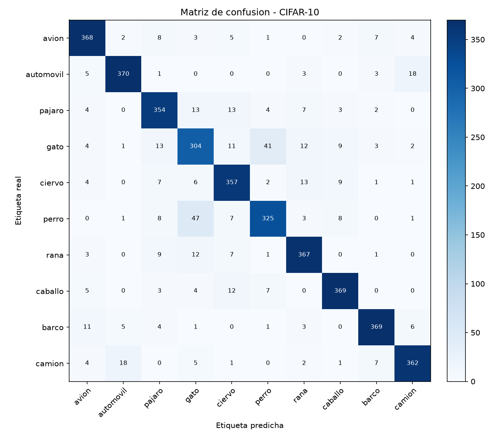

# PRO_avan - Ventas de videojuegos + vision por computadora

Proyecto final que integra dos flujos de machine learning en una sola
aplicacion web:

1. **Regresion tabular**: prediccion de ventas globales de videojuegos a partir
   de plataforma, genero, editorial y ano.
2. **Vision por computadora**: clasificacion de imagenes CIFAR-10 con transfer
   learning, captura desde camara o subida de archivo.

La webapp Flask conserva el flujo original de ventas y agrega el modulo de
vision como una funcionalidad aditiva, sin romper la API ni el frontend
existentes. La imagen se traduce en un perfil aproximado del videojuego
(plataforma, genero, editorial y ano) y ese perfil alimenta el modelo de ventas.

## Arquitectura

```
Navegador (Bootstrap + JS)
   |-- formulario de ventas ---------> Flask webapp :5000
   |-- camara / archivo de imagen ---> Flask webapp :5000
                                            |
                    +-----------------------+-----------------------+
                    |                                               |
                    v                                               v
        FastAPI regresion :8000                         FastAPI vision :8100
        modelo joblib (ventas)                          MobileNetV3-Small (CIFAR-10)
                    ^                                               |
                    |                                               v
                    +------------- perfil inferido <----------------+
                                  plataforma, genero,
                                  editorial y ano
                                            |
                                            v
                                 PostgreSQL :5432
          usuarios, predictions, vision_predictions (enlazadas), audit_logs
```

### Componentes

| Ruta | Tecnologia | Responsabilidad |
|---|---|---|
| `API_regresion_lineal_multiple/` | FastAPI + joblib | API original de regresion de ventas (sin cambios) |
| `vision_api/` | FastAPI + PyTorch | Entrenamiento e inferencia CIFAR-10 |
| `video_games_web/` | Flask + SQLAlchemy + Bootstrap | Frontend, autenticacion, historiales, auditoria y Docker Compose |
| `video_games_web/docker-compose.yml` | Docker Compose | PostgreSQL, API de ventas, Vision API y webapp |

## Cobertura de la rubrica

| Criterio | Implementacion |
|---|---|
| Dataset de vision | CIFAR-10 cargado con `torchvision`, 20 000 train / 4 000 test balanceados |
| Modelo con transfer learning | MobileNetV3-Small preentrenado en ImageNet, backbone congelado y cabeza reentrenada |
| Backend / API | Flask recibe la imagen; FastAPI `/predict` valida, clasifica y devuelve top-k, confianza, latencia y version |
| Frontend con captura | Pagina `/vision` con `getUserMedia`, captura a canvas, subida JPG/PNG/WebP y visualizacion de resultados |
| Integracion con ventas | La clase visual se traduce en un perfil de videojuego y se envia a la API de regresion para estimar ventas globales |
| Persistencia | `vision_predictions` enlazada con `predictions` en PostgreSQL + auditoria de acciones |
| Docker | Servicio `vision` en Docker Compose con healthcheck y modelo incluido |
| Git y documentacion | Repositorio Git, README raiz, README de vision y README de la webapp |

## Resultados del modelo

| Metrica | Valor |
|---|---|
| Accuracy test | **88.63 %** |
| Macro precision | 88.62 % |
| Macro recall | 88.63 % |
| Macro F1 | 88.61 % |
| Clases | avion, automovil, pajaro, gato, ciervo, perro, rana, caballo, barco, camion |




El checkpoint, las metricas completas y las figuras estan en
`vision_api/artifacts/`.

## Como ejecutar con Docker

Docker Compose levanta PostgreSQL, la API de ventas, la Vision API y la webapp
Flask con un solo comando. El checkpoint del modelo de vision ya esta incluido,
por lo que no hace falta entrenar nada.

### Requisitos

- Docker Desktop instalado y en ejecucion.
- Docker Compose v2 (`docker compose version`).
- Puertos libres: `5000` (webapp), `8000` (API de ventas), `8100` (Vision API)
  y `5432` (PostgreSQL).
- Si ya tienes un PostgreSQL local usando `5432`, cambia `POSTGRES_PORT` en
  `.env`; en la seccion de problemas se explica.

### 1. Preparar el archivo `.env`

Todos los comandos se ejecutan desde `video_games_web`, porque los contextos de
construccion apuntan a las carpetas de las APIs.

PowerShell:

```powershell
cd video_games_web
Copy-Item .env.example .env
```

Linux/macOS:

```bash
cd video_games_web
cp .env.example .env
```

Edita `.env` y cambia al menos:

```env
SECRET_KEY=una-clave-larga-y-aleatoria
POSTGRES_PASSWORD=una-contrasena-segura
```

Opcionalmente puedes cambiar los puertos publicados:

```env
WEBAPP_PORT=5000
API_PORT=8000
VISION_PORT=8100
POSTGRES_PORT=5432
```

`POSTGRES_PORT` solo afecta al puerto expuesto en tu equipo. Dentro de Docker,
la webapp sigue usando `postgres:5432`.

### 2. Construir y levantar los servicios

```powershell
docker compose up --build -d
```

La primera ejecucion puede tardar varios minutos porque descarga las imagenes
base e instala PyTorch para la Vision API. El contenedor `webapp` aplica las
migraciones automaticamente (`flask db upgrade`) antes de arrancar Gunicorn.

### 3. Verificar que todo este arriba

```powershell
docker compose ps
```

Deben aparecer `postgres`, `api`, `vision` y `webapp`. `postgres`, `api` y
`vision` deben estar `healthy`. Tambien puedes probar las APIs:

PowerShell:

```powershell
Invoke-RestMethod http://localhost:8000/health
Invoke-RestMethod http://localhost:8100/health
```

Linux/macOS:

```bash
curl http://localhost:8000/health
curl http://localhost:8100/health
```

| Servicio | URL |
|---|---|
| Webapp Flask | <http://localhost:5000> |
| API de ventas | <http://localhost:8000> |
| Swagger de ventas | <http://localhost:8000/docs> |
| Vision API | <http://localhost:8100> |
| Swagger de vision | <http://localhost:8100/docs> |
| PostgreSQL | `localhost:5432` o el valor de `POSTGRES_PORT` |

### 4. Usar la aplicacion

1. Abre <http://localhost:5000>.
2. Registrate o inicia sesion.
3. Entra en **Ventas por imagen**.
4. Sube una portada/captura o usa la camara.
5. Revisa la venta estimada y corrige el perfil si es necesario.
6. Consulta el historial de vision o el historial de ventas.

La camara funciona en `localhost` o mediante HTTPS. Para probar sin camara,
sube una imagen JPG, PNG o WebP desde la misma pagina. La imagen no identifica
el titulo real del juego: el flujo infiere un perfil aproximado (plataforma,
genero, editorial y ano), lo envia a la API de regresion y muestra la venta
estimada en millones. El perfil se puede corregir y recalcular.

### 5. Crear un administrador (opcional)

```powershell
docker compose exec webapp flask create-admin
```

### 6. Logs, parada y reconstruccion

Ver logs en vivo:

```powershell
docker compose logs -f webapp vision
```

Detener sin borrar datos:

```powershell
docker compose down
```

Volver a levantar:

```powershell
docker compose up -d
```

Despues de cambiar codigo o dependencias:

```powershell
docker compose up -d --build webapp
```

Para detener y borrar tambien la base de datos persistida en el volumen:

```powershell
docker compose down -v
```

Esto ultimo elimina usuarios, historiales y predicciones. Usalo solo si quieres
empezar desde cero.

### 7. Problemas comunes

- **El puerto 5432 esta ocupado por un PostgreSQL local.** Cambia en `.env`
  `POSTGRES_PORT=5433` y ejecuta `docker compose up -d postgres`. La webapp no
  se ve afectada porque dentro de Docker usa `postgres:5432`. Si usas pgAdmin
  o un cliente local, conectate a `localhost:5433`.
- **El puerto 5000, 8000 u 8100 esta ocupado.** Cambia `WEBAPP_PORT`, `API_PORT`
  o `VISION_PORT` en `.env` y ejecuta `docker compose up -d`.
- **`webapp` no arranca o aparece unhealthy.** Revisa
  `docker compose logs webapp`; normalmente indica que falta `.env`, que
  PostgreSQL no esta listo o que una migracion fallo.
- **La Vision API no responde.** Revisa `docker compose logs vision` y confirma
  que `vision` este `healthy` en `docker compose ps`.
- **Quiero verificar las migraciones aplicadas.**

  ```powershell
  docker compose exec webapp flask db current
  ```

## Entrenamiento del modelo de vision

El repositorio incluye `vision_api/artifacts/model.pt`, por lo que Docker no
necesita entrenar. Para reproducir el entrenamiento:

```powershell
cd vision_api
python -m venv .venv
.\.venv\Scripts\activate
python -m pip install -r requirements-train.txt
python train.py
```

El script descarga CIFAR-10 (con mirror alternativo configurable mediante
`CIFAR10_URL`), extrae caracteristicas con MobileNetV3-Small congelado, entrena
la cabeza clasificadora y regenera:

- `artifacts/model.pt`
- `artifacts/classes.json`
- `artifacts/metrics.json`
- `artifacts/figures/confusion_matrix.png`
- `artifacts/figures/training_curves.png`
- `artifacts/figures/sample_predictions.png`

## Desarrollo local sin Docker

1. API de ventas:

   ```powershell
   cd API_regresion_lineal_multiple
   python -m uvicorn api.main:app --port 8000
   ```

2. Vision API:

   ```powershell
   cd vision_api
   .\.venv\Scripts\activate
   python -m uvicorn api.main:app --port 8100
   ```

3. Webapp:

   ```powershell
   cd video_games_web
   python -m pip install -r requirements-dev.txt
   Copy-Item .env.example .env
   python -m flask --app wsgi db upgrade
   python wsgi.py
   ```

   Ajusta en `.env`:

   ```env
   API_BASE_URL=http://127.0.0.1:8000
   VISION_API_BASE_URL=http://127.0.0.1:8100
   ```

## Pruebas

```powershell
cd vision_api
.\.venv\Scripts\python -m pytest -q

cd ..\video_games_web
python -m pytest -q
```

- Vision API: endpoints con servicio simulado y prueba de humo del modelo real.
- Webapp: autenticacion, ventas, vision, historiales, auditoria, permisos y
  clientes HTTP simulados.

## Estructura del repositorio

```
PRO_avan/
  API_regresion_lineal_multiple/   API FastAPI original de ventas
  vision_api/                      Entrenamiento + API de vision
    api/                           Endpoints FastAPI
    src/                           Modelo, clases, transforms y config
    artifacts/                     model.pt, metricas y figuras
    tests/
    train.py
    Dockerfile
  video_games_web/                 Webapp Flask + Docker Compose
    app/
      blueprints/vision/           Clasificacion, venta inferida, recalculo e historial
      models/vision_prediction.py  Tabla vision_predictions enlazada a predictions
      services/game_profile.py     Perfil de videojuego inferido desde CIFAR-10
      services/vision_client.py    Cliente httpx hacia la Vision API
      templates/vision/            UI de captura, resultado de ventas e historial
      static/js/vision.js          Camara, canvas, fetch y CSRF
    migrations/                    Migraciones de vision y enlace con ventas
    tests/
    docker-compose.yml
  README.md
```

## Notas

- El modulo de vision es una demostracion academica: CIFAR-10 contiene imagenes
  de 32 x 32 y las fotos reales pueden tener otra distribucion.
- La imagen no identifica el titulo ni la editorial real. El sistema infiere un
  perfil aproximado a partir del tema visual; el usuario puede corregirlo antes
  de recalcular la venta.
- Las predicciones de ventas tambien son aproximadas; el modelo explica solo
  una parte de la variabilidad.
- No se versionan `.env`, bases SQLite locales, logs ni el dataset descargado.
  El checkpoint `model.pt` si se versiona porque Docker lo necesita.
