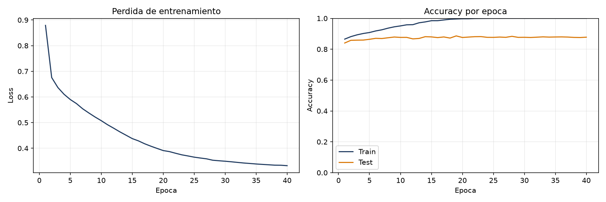

# PRO_avan - Ventas de videojuegos + vision por computadora

Proyecto final que integra dos flujos de machine learning en una sola
aplicacion web:

1. **Regresion tabular**: prediccion de ventas globales de videojuegos a partir
   de plataforma, genero, editorial y ano.
2. **Vision por computadora**: clasificacion de imagenes CIFAR-10 con transfer
   learning, captura desde camara o subida de archivo.

La webapp Flask conserva el flujo original de ventas y agrega el modulo de
vision como una funcionalidad aditiva, sin romper la API ni el frontend
existentes.

## Arquitectura

```
Navegador (Bootstrap + JS)
   |-- formulario de ventas ---------> Flask webapp :5000
   |-- camara / archivo de imagen ---> Flask webapp :5000
                                            |
                    +-----------------------+-----------------------+
                    |                                               |
                    v                                               v
        FastAPI regresion :8000                         FastAPI vision :8100
        modelo joblib (ventas)                          MobileNetV3-Small (CIFAR-10)
                    |                                               |
                    +-----------------------+-----------------------+
                                            |
                                            v
                                 PostgreSQL :5432
                    usuarios, predictions, vision_predictions, audit_logs
```

### Componentes

| Ruta | Tecnologia | Responsabilidad |
|---|---|---|
| `API_regresion_lineal_multiple/` | FastAPI + joblib | API original de regresion de ventas (sin cambios) |
| `vision_api/` | FastAPI + PyTorch | Entrenamiento e inferencia CIFAR-10 |
| `video_games_web/` | Flask + SQLAlchemy + Bootstrap | Frontend, autenticacion, historiales, auditoria y Docker Compose |
| `video_games_web/docker-compose.yml` | Docker Compose | PostgreSQL, API de ventas, Vision API y webapp |

## Cobertura de la rubrica

| Criterio | Implementacion |
|---|---|
| Dataset de vision | CIFAR-10 cargado con `torchvision`, 20 000 train / 4 000 test balanceados |
| Modelo con transfer learning | MobileNetV3-Small preentrenado en ImageNet, backbone congelado y cabeza reentrenada |
| Backend / API | Flask recibe la imagen; FastAPI `/predict` valida, clasifica y devuelve top-k, confianza, latencia y version |
| Frontend con captura | Pagina `/vision` con `getUserMedia`, captura a canvas, subida JPG/PNG/WebP y visualizacion de resultados |
| Persistencia | Tabla `vision_predictions` en PostgreSQL + auditoria de acciones |
| Docker | Servicio `vision` en Docker Compose con healthcheck y modelo incluido |
| Git y documentacion | Repositorio Git, README raiz, README de vision y README de la webapp |

## Resultados del modelo

| Metrica | Valor |
|---|---|
| Accuracy test | **88.63 %** |
| Macro precision | 88.62 % |
| Macro recall | 88.63 % |
| Macro F1 | 88.61 % |
| Clases | avion, automovil, pajaro, gato, ciervo, perro, rana, caballo, barco, camion |




El checkpoint, las metricas completas y las figuras estan en
`vision_api/artifacts/`.

## Arranque rapido con Docker

Requisitos: Docker Desktop con Docker Compose.

```powershell
cd video_games_web
Copy-Item .env.example .env
# edita .env y cambia SECRET_KEY y POSTGRES_PASSWORD
docker compose up --build
```

Servicios:

| Servicio | URL |
|---|---|
| Webapp | <http://localhost:5000> |
| API de ventas | <http://localhost:8000/docs> |
| Vision API | <http://localhost:8100/docs> |
| PostgreSQL | `localhost:5432` |

Crea un administrador si lo necesitas:

```powershell
docker compose exec webapp flask create-admin
```

La camara funciona en `localhost` o mediante HTTPS. Para probar sin camara,
sube una imagen JPG, PNG o WebP desde la misma pagina.

## Entrenamiento del modelo de vision

El repositorio incluye `vision_api/artifacts/model.pt`, por lo que Docker no
necesita entrenar. Para reproducir el entrenamiento:

```powershell
cd vision_api
python -m venv .venv
.\.venv\Scripts\activate
pip install -r requirements-train.txt
python train.py
```

El script descarga CIFAR-10 (con mirror alternativo configurable mediante
`CIFAR10_URL`), extrae caracteristicas con MobileNetV3-Small congelado, entrena
la cabeza clasificadora y regenera:

- `artifacts/model.pt`
- `artifacts/classes.json`
- `artifacts/metrics.json`
- `artifacts/figures/confusion_matrix.png`
- `artifacts/figures/training_curves.png`
- `artifacts/figures/sample_predictions.png`

## Desarrollo local sin Docker

1. API de ventas:

   ```powershell
   cd API_regresion_lineal_multiple
   python -m uvicorn api.main:app --port 8000
   ```

2. Vision API:

   ```powershell
   cd vision_api
   .\.venv\Scripts\activate
   python -m uvicorn api.main:app --port 8100
   ```

3. Webapp:

   ```powershell
   cd video_games_web
   pip install -r requirements-dev.txt
   Copy-Item .env.example .env
   python -m flask --app wsgi db upgrade
   python wsgi.py
   ```

   Ajusta en `.env`:

   ```env
   API_BASE_URL=http://127.0.0.1:8000
   VISION_API_BASE_URL=http://127.0.0.1:8100
   ```

## Pruebas

```powershell
cd vision_api
.\.venv\Scripts\python -m pytest -q

cd ..\video_games_web
python -m pytest -q
```

- Vision API: endpoints con servicio simulado y prueba de humo del modelo real.
- Webapp: autenticacion, ventas, vision, historiales, auditoria, permisos y
  clientes HTTP simulados.

## Estructura del repositorio

```
PRO_avan/
  API_regresion_lineal_multiple/   API FastAPI original de ventas
  vision_api/                      Entrenamiento + API de vision
    api/                           Endpoints FastAPI
    src/                           Modelo, clases, transforms y config
    artifacts/                     model.pt, metricas y figuras
    tests/
    train.py
    Dockerfile
  video_games_web/                 Webapp Flask + Docker Compose
    app/
      blueprints/vision/           Rutas de camara, prediccion e historial
      models/vision_prediction.py  Tabla vision_predictions
      services/vision_client.py    Cliente httpx hacia la Vision API
      templates/vision/            UI de captura, resultado e historial
      static/js/vision.js          Camara, canvas, fetch y CSRF
    migrations/                    Migracion de vision_predictions
    tests/
    docker-compose.yml
  README.md
```

## Notas

- El modulo de vision es una demostracion academica: CIFAR-10 contiene imagenes
  de 32 x 32 y las fotos reales pueden tener otra distribucion.
- Las predicciones de ventas tambien son aproximadas; el modelo explica solo
  una parte de la variabilidad.
- No se versionan `.env`, bases SQLite locales, logs ni el dataset descargado.
  El checkpoint `model.pt` si se versiona porque Docker lo necesita.
